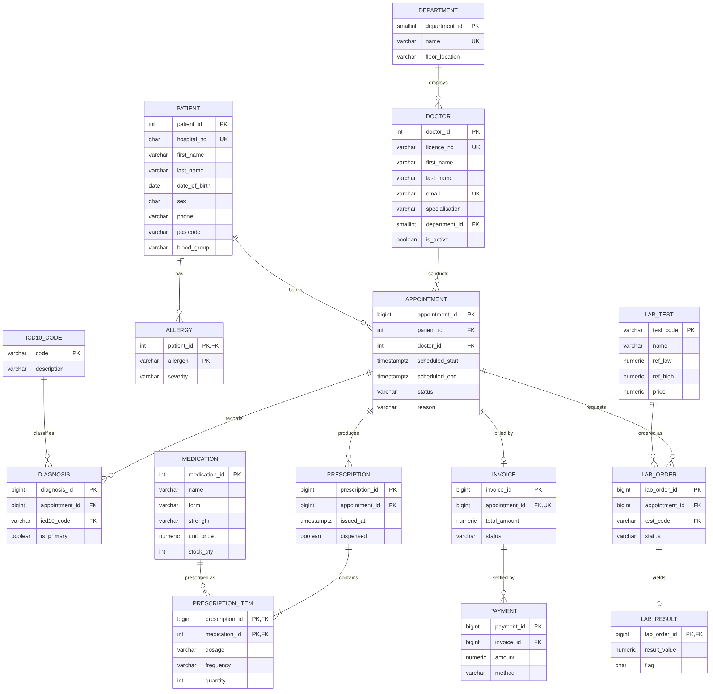

# Portfolio 1 – Database Design and Modelling

## 1. Selected case study: CarePoint Clinic (simulated organisation)

| Item | Description |
|---|---|
| **Organisation** | CarePoint Clinic: a fictional multi-specialty outpatient clinic with 8 departments and 60 doctors serving about 20,000 registered patients |
| **Nature of the business** | Outpatient consultations, prescribing, diagnostic laboratory tests and billing |
| **Database users** | Reception staff (registration and booking), doctors (diagnosis, prescribing, ordering tests), pharmacy (dispensing and stock), lab scientists (results), finance (invoices and payments), managers (reporting) |
| **Major data stored** | Patients, allergies, departments, doctors, appointments, diagnoses (ICD-10), medications and stock, prescriptions, lab tests, orders and results, invoices, payments, audit log |
| **Key operations** | Register patient · book, cancel or complete appointment · record diagnosis · prescribe and dispense (decrements stock) · order lab test and record result · raise invoice and take payment · retrieve full patient history · departmental and financial reporting |

All later portfolios (2–5) use this same case study.

## 2. Files

| File | Purpose |
|---|---|
| `erd.mmd` / `erd.png` | ER diagram in crow's-foot notation (Mermaid source and rendered image) |
| `schema.sql` | Full DDL: 15 tables, keys, constraints, trigger and view |
| `seed_data.sql` | Deterministic synthetic data generator (about 150k appointments) |
| `constraint_tests.sql` | Statements that *should fail*, which proves the constraints are enforced |
| `evidence/` | Captured output: row counts and constraint test results |

### How to run (PostgreSQL 16)
```bash
createdb carepoint
psql -d carepoint -f schema.sql
psql -d carepoint -f seed_data.sql          # ~15 s
psql -d carepoint -f constraint_tests.sql   # each test prints the expected ERROR
```

## 3. ER diagram



**Main relationships**

- A patient has many appointments, and a doctor conducts many. `APPOINTMENT` is the central **associative entity** that resolves the M:N relationship between `PATIENT` and `DOCTOR`, and it carries its own attributes (time, status, reason).
- A prescription contains many medications, and a medication appears on many prescriptions. This M:N relationship is resolved by `PRESCRIPTION_ITEM`, which has the composite PK `(prescription_id, medication_id)`.
- `LAB_ORDER` to `LAB_RESULT` is **1 : 0..1**. The result is a weak entity whose PK is also its FK.
- `APPOINTMENT` to `INVOICE` is **1 : 0..1**, enforced with `UNIQUE(appointment_id)` on invoice.
- An allergy is a **multi-valued attribute** of a patient, so it gets its own table (see 1NF below).

## 4. Relational schema (keys in short form)

```
DEPARTMENT(department_id PK, name UK, floor_location)
DOCTOR(doctor_id PK, licence_no UK, first_name, last_name, email UK, phone, specialisation, department_id FK→DEPARTMENT, is_active)
PATIENT(patient_id PK, hospital_no UK, first_name, last_name, date_of_birth, sex, phone, email, address_line, city, postcode, blood_group, registered_at)
ALLERGY(patient_id PK/FK→PATIENT, allergen PK, severity)
ICD10_CODE(code PK, description)
MEDICATION(medication_id PK, name, form, strength, unit_price, stock_qty)   UK(name, form, strength)
LAB_TEST(test_code PK, name, unit, ref_low, ref_high, price)
APPOINTMENT(appointment_id PK, patient_id FK, doctor_id FK, scheduled_start, scheduled_end, status, reason, created_at)
DIAGNOSIS(diagnosis_id PK, appointment_id FK, icd10_code FK, is_primary, notes)   UK(appointment_id, icd10_code)
PRESCRIPTION(prescription_id PK, appointment_id FK, issued_at, dispensed)
PRESCRIPTION_ITEM(prescription_id PK/FK, medication_id PK/FK, dosage, frequency, duration_days, quantity)
LAB_ORDER(lab_order_id PK, appointment_id FK, test_code FK, ordered_at, status)
LAB_RESULT(lab_order_id PK/FK, result_value, flag, resulted_at)
INVOICE(invoice_id PK, appointment_id FK UK, total_amount, status, issued_at)
PAYMENT(payment_id PK, invoice_id FK, amount, method, paid_at)
AUDIT_LOG(audit_id PK, table_name, row_pk, action, old_data JSONB, new_data JSONB, changed_by, changed_at)
```

**Key design decisions**

- **Surrogate keys** (`GENERATED ALWAYS AS IDENTITY`) are used on entity tables, because business identifiers such as an email address can change. The real-world identifiers (`hospital_no`, `licence_no`) are still protected with `UNIQUE`, so they remain candidate keys.
- **Natural keys** are used for stable code lists (`icd10_code.code`, `lab_test.test_code`), so their FK values are readable without a join.
- `TIMESTAMPTZ` is used for every point in time, so the data stays correct if the clinic later operates across time zones (relevant to Portfolio 5).

## 5. Integrity constraints

| Type | Example | Business rule |
|---|---|---|
| Entity integrity | PKs on every table | Every row is uniquely identifiable |
| Referential integrity | `appointment.patient_id → patient` | No appointment can exist for an unknown patient |
| Domain (CHECK) | `status IN ('BOOKED','COMPLETED','CANCELLED','NO_SHOW')`, `blood_group`, `sex` | Only valid codes can be stored |
| Business rule (CHECK) | `stock_qty >= 0` | The pharmacy can never dispense stock it doesn't have |
| Multi-column CHECK | `scheduled_end > scheduled_start` and at most 2 h; `ref_low <= ref_high` | Consistent ranges |
| Uniqueness | `hospital_no`, `licence_no`, `(name, form, strength)` | No duplicate patients or products |
| **Exclusion constraint** (advanced) | `EXCLUDE USING gist (doctor_id WITH =, tstzrange(start,end) WITH &&) WHERE status <> 'CANCELLED'` | **A doctor cannot be double-booked**, even for partially overlapping times. Cancelled slots are released for rebooking. A plain UNIQUE constraint can't express this. |
| Cascading | `ON DELETE CASCADE` on allergy, prescription_item and lab_result | Dependent or weak rows go with their parent |
| Trigger | `audit_appointment_status` | Every status change or deletion is written to `audit_log` as JSONB (clinical accountability) |

`evidence/constraint_tests_output.txt` shows each rule rejecting invalid data. Test 8 also shows that a cancelled slot can be rebooked and that the audit trigger fires.

> Design note: the first version stored `duration_min` and computed the end time inside the exclusion constraint. PostgreSQL rejected this (`functions in index expression must be marked IMMUTABLE`), because `timestamptz + interval` depends on the session time zone. I changed the design to store `scheduled_end` explicitly, with a CHECK that bounds the duration.
>
> A known caveat: `CHECK (date_of_birth <= CURRENT_DATE)` uses a non-immutable function. PostgreSQL only evaluates it on insert or update, which is the behaviour we want here.

## 6. Normalisation

**Starting point: an un-normalised "clinic visit form"** as reception might keep it in a spreadsheet:

```
VISIT(visit_no, visit_date, patient_hospital_no, patient_name, patient_dob, patient_phone, allergies{...},
      doctor_licence, doctor_name, dept_name, dept_floor, diagnosis_code, diagnosis_desc,
      {medication_name, strength, unit_price, dosage, qty}, {test_code, test_name, test_price, result}, invoice_total, amount_paid)
```

**1NF: remove repeating groups and multi-valued attributes**
- `allergies{}` was split into `ALLERGY(patient, allergen, severity)`.
- The medication group was split into rows keyed by `(visit_no, medication)`.
- The lab test group was split into rows keyed by `(visit_no, test_code)`.
- Names were split into atomic `first_name` and `last_name`.

**2NF: remove partial dependencies on part of a composite key**
- In `(visit_no, medication) → dosage, qty, medication_name, strength, unit_price`, the attributes `medication_name, strength, unit_price` depend only on the medication. They were moved to `MEDICATION`. The remaining `PRESCRIPTION_ITEM` holds only what depends on the whole key.
- In `(visit_no, test_code) → test_name, test_price`, the test attributes were moved to `LAB_TEST`.

**3NF: remove transitive dependencies**
- `visit_no → doctor_licence → doctor_name, dept_name`, and `dept_name → dept_floor`. These became `DOCTOR` and `DEPARTMENT`, and the visit keeps only `doctor_id`.
- `visit_no → patient_hospital_no → patient_name, dob, phone`. These became `PATIENT`.
- `diagnosis_code → diagnosis_desc`. This became `ICD10_CODE`.

**BCNF check:** in every table, every non-trivial determinant is a candidate key. For example, in `DOCTOR` both `licence_no` and `email` determine all other attributes, and both are declared UNIQUE, so they are candidate keys. No table has a determinant that is not a key.

**Controlled denormalisation (deliberate):**
- `invoice.total_amount` is derivable from lab prices plus the consultation fee. It is stored because an invoice is a legal document that must not change if a price list changes later. It records the amount *at the time of issue*.
- `audit_log.old_data/new_data` are JSONB snapshots, by design.

## 7. Data volume (from `evidence/seed_row_counts.txt`)

| Table | Rows | | Table | Rows |
|---|---|---|---|---|
| patient | 20,000 | | prescription | 69,837 |
| doctor | 60 | | prescription_item | 102,301 |
| appointment | 150,512 | | lab_order / lab_result | 35,013 |
| diagnosis | 116,487 | | invoice | 116,487 |
| allergy | 3,787 | | payment | 107,334 |

Foreign key columns are **deliberately not indexed** in this baseline (PostgreSQL does not index FKs automatically). Portfolio 2 measures the cost of this and fixes it.
