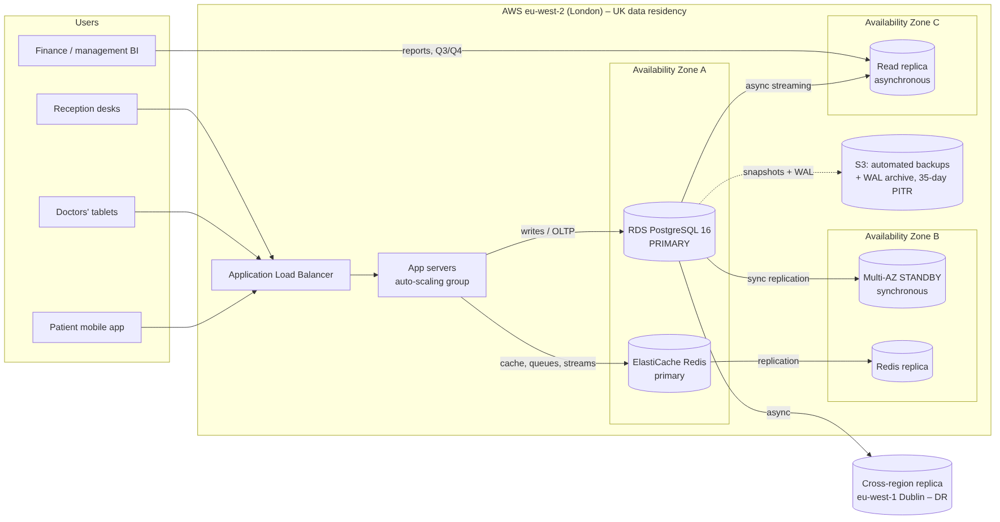

# Portfolio 5 – Distributed and Cloud Database Exercise

**Case study:** CarePoint Clinic, which is expanding from one site (London) to a second site (Manchester) and a patient mobile app.

The exercise has three parts, and all of them use the real CarePoint data (150k appointments):

| Part | What was built | Evidence |
|---|---|---|
| A. Replication and failover | A 2-node PostgreSQL 16 cluster: primary (London, :5440) and hot standby (Manchester, :5441) using streaming replication and a replication slot | `replication/replication_lab.sh` → `evidence/replication_output.txt` |
| B. Horizontal sharding | A coordinator plus 2 shard nodes. `appointment` is hash-partitioned on `patient_id` across 4 partitions using `postgres_fdw` | `sharding/sharding_lab.sh` → `evidence/sharding_output.txt` |
| C. Cloud deployment design | AWS architecture with Multi-AZ, read replica, cache, backups and DR | `cloud/architecture.png` and section C below |

```bash
sudo -u postgres bash replication/replication_lab.sh | tee evidence/replication_output.txt
sudo -u postgres bash sharding/sharding_lab.sh      | tee evidence/sharding_output.txt
```
Both scripts build their nodes from scratch in `/tmp`, copy data from the `carepoint` database on :5432, and stop the nodes when they finish. All nodes run on one machine on different ports, which simulates separate servers.

---

## A. Replication, consistency and availability (`evidence/replication_output.txt`)

| Step | Result |
|---|---|
| R1–R2 | Primary initialised with `wal_level=replica` and a physical replication slot `node2_manchester`. The standby was cloned with `pg_basebackup -R`, which writes `standby.signal` and `primary_conninfo`. |
| R3 | `pg_stat_replication` on the primary shows `node2_manchester state=streaming sync_state=async`. `pg_stat_wal_receiver` on the standby shows `streaming`, and `pg_is_in_recovery() = true`. |
| R4 | Patient `CP90000001` inserted on the primary was readable on the standby within 0.5 s. |
| R5 | A write on the standby fails with `ERROR: cannot execute INSERT in a read-only transaction`. |
| R6 | An analytical report (consultations per department) ran on the **replica**, so reporting load is kept off the primary. |
| R7 | **Replication lag** during a 20,000-row update burst: up to **9.7 MB of WAL behind**, back to 0 bytes within a second. Async replicas are *eventually consistent*. |
| R8 | Switched to `synchronous_standby_names='node2_manchester'` (`sync_state = sync`). 200 commits took **117 ms async vs 168 ms sync** (+44%), even on one machine. Between two real sites each commit would also pay the network round-trip. |
| R9 | **CAP in practice:** in sync mode with the standby stopped, the primary is up but a commit **waits indefinitely** (`wait_event = SyncRep`). After cancelling, PostgreSQL warned *"committed locally, but might not have been replicated"*. Switching back to async restored writes immediately. When the standby restarted, it **caught up automatically** from the WAL kept by the slot (both Z00.0 and Z00.1 were present). |
| R10 | **Failover:** the primary was killed with `stop -m immediate`. `pg_promote()` turned the standby into a read-write primary in **138 ms**, on **timeline 2**. A new patient `CP90000003` was written to it. The old primary must be rebuilt as a standby (`pg_rewind`) to avoid **split-brain**. |

**Interpretation (CAP / PACELC)**
- During a **partition** (R9), CarePoint must choose. **Synchronous** replication favours **Consistency**: no confirmed commit can be lost on failover (RPO = 0), but writes stop if the standby is unreachable. **Asynchronous** replication favours **Availability**: writes continue, but the last few commits could be lost on failover (RPO > 0, see R7's lag).
- With **no partition** there is still a trade-off between **latency and consistency** (R8: +44% commit time for sync).
- **Recommendation:** use *synchronous* replication to a standby in a nearby availability zone (low latency, RPO = 0 for clinical records), and *asynchronous* replication to the remote site and reporting replicas. This is the design in section C.

---

## B. Sharding (`evidence/sharding_output.txt`)

**Shard key choice: `patient_id` (hash, modulus 4)**
- The most frequent queries are per patient (history, billing, labs). Hashing on `patient_id` keeps **all of one patient's rows on the same shard**, so those queries touch one node.
- Hashing spreads the load evenly. Range sharding by date would put all of today's bookings on one "hot" shard.

| Step | Result |
|---|---|
| S3 | Parent table `appointment PARTITION BY HASH (patient_id)`. Each partition is a **foreign table** on a remote shard via `postgres_fdw`. |
| S4 | 150,512 rows loaded *through the coordinator* and routed automatically: shard1 holds p0 = 37,455 and p1 = 38,158; shard2 holds p2 = 37,614 and p3 = 37,285. The spread is within ±1.4% of an even split. |
| S5 | `WHERE patient_id = 12345` gives **partition pruning**: the plan contains a single `Foreign Scan on appointment_p0` and the `WHERE` clause is pushed to the shard (`Remote SQL: … WHERE ((patient_id = 12345))`). Only one node does any work. |
| S6 | A global `GROUP BY status` is a **scatter-gather** query: 4 foreign scans with *partial* aggregates, finalised on the coordinator. Only the `status` column is shipped (projection pushdown). This is the expensive pattern that sharding makes worse, so such reports belong on a replica or data warehouse. |
| S7 | **Partial failure:** with shard2 down, patient 12345 (on shard1) **was still served**, because plan-time pruning means shard2 is never contacted. The global count failed (`could not connect to server "shard2"`). After shard2 restarted, the global count returned 150,512. Sharding limits the blast radius but does not provide HA on its own, so each shard still needs replicas (part A). |

**Limitations noted**
- Cross-shard transactions need two-phase commit, which `postgres_fdw` does not coordinate atomically.
- Cross-shard unique constraints and foreign keys are not enforced.
- Re-sharding (changing the modulus) means moving data.
- Production options: Citus (distributed PostgreSQL), Amazon Aurora Limitless, or application-level routing.
- **At CarePoint's current size (about 150k appointments a year), a single primary with replicas is enough.** Sharding is designed here as a growth path, for example a regional network of 50+ clinics.

---

## C. Cloud deployment design



| Concern | Design choice | Link to evidence |
|---|---|---|
| **Data residency / compliance** | AWS **eu-west-2 (London)** for all primary data (UK GDPR, NHS DSPT expectations). DR copy in eu-west-1 (Dublin), which has a UK adequacy decision. Encryption at rest (KMS) and in transit (TLS). | – |
| **High availability** | **RDS PostgreSQL Multi-AZ**: a synchronous standby in a second AZ with automatic failover (typically 60–120 s) | Part A: R8, R10 |
| **Read scaling** | 1 asynchronous **read replica** in AZ-C for BI and reports (Portfolio 2 Q3/Q4, materialised views) | R6, R7 |
| **Caching / real-time** | **ElastiCache for Redis** with a replica: patient cache, queues, streams | Portfolio 4 |
| **Backup / recovery** | Automated snapshots plus WAL archiving to S3 → **point-in-time recovery**, 35-day retention | WAL / replication slot (R9) |
| **Disaster recovery** | Cross-region async replica. Targets: **RPO ≤ 5 min, RTO ≤ 1 h** for a region failure; **RPO = 0, RTO ≈ 2 min** for an AZ failure | R10 |
| **Scaling path** | Vertical first (larger instance class), then more read replicas, then shard by `patient_id` (Citus / Aurora Limitless) | Part B |
| **Security** | Private subnets, no public DB endpoint, IAM database authentication, least-privilege roles (reception / doctor / finance), `audit_log` trigger plus CloudTrail | Portfolio 1 trigger |
| **Monitoring** | CloudWatch alarms on `ReplicaLag`, CPU and free storage; `pg_stat_statements` for slow queries | R7, Portfolio 2 |

**Indicative monthly cost** (on-demand, London; approximate at the time of writing, check the AWS pricing calculator):
- RDS db.m6g.large Multi-AZ plus 100 GB gp3: about £300
- 1 read replica: about £130
- ElastiCache cache.t4g.small with a replica: about £50
- Backups and transfer: about £30
- **Total: about £500/month.** A managed service removes patching, backup and failover operations, which a small clinic IT team could not staff around the clock.
